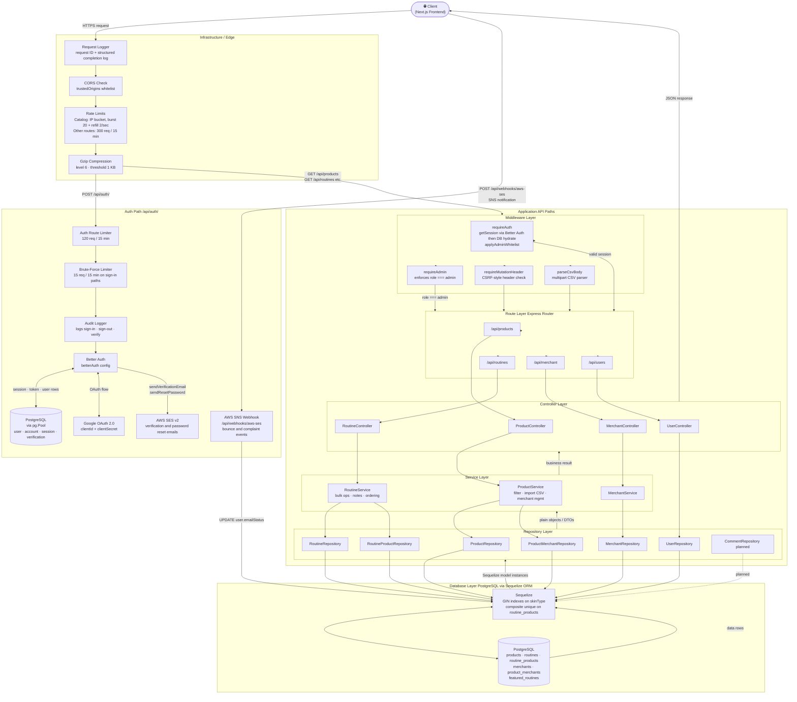

# ClearUp — Backend Architecture

> **Stack**: Node.js · Express · TypeScript · Sequelize ORM · PostgreSQL · Better Auth · AWS SES / SNS

---

## 1. Entity-Relationship (ER) Diagram

> Models live in `backend/src/models/`. Associations are wired in `backend/src/associations.ts`.
> Better Auth owns `user`, `account`, `session`, and `verification` (managed via its own `pg` Pool).
> Application logic owns the remaining tables.

```mermaid
erDiagram
    %% ─────────────────────────────────────────────
    %% AUTH LAYER  (managed by Better Auth)
    %% ─────────────────────────────────────────────

    USER {
        string  id              PK
        string  name
        string  email           UK
        boolean emailVerified
        string  emailStatus     "active | bounced | complained"
        string  image
        string  role            "user | admin"
        boolean banned
        string  banReason
        date    banExpires
        date    createdAt
        date    updatedAt
    }

    ACCOUNT {
        string  id                    PK
        string  accountId
        string  providerId            "credential | google"
        string  userId                FK
        text    accessToken
        text    refreshToken
        text    idToken
        date    accessTokenExpiresAt
        date    refreshTokenExpiresAt
        string  scope
        string  password              "hashed; credentials only"
        date    createdAt
        date    updatedAt
    }

    SESSION {
        string  id          PK
        date    expiresAt
        string  token       UK
        string  ipAddress
        string  userAgent
        string  userId      FK
        date    createdAt
        date    updatedAt
    }

    VERIFICATION {
        string  id          PK
        string  identifier  "email address"
        text    value       "signed token"
        date    expiresAt
        date    createdAt
        date    updatedAt
    }

    %% ─────────────────────────────────────────────
    %% APPLICATION LAYER
    %% ─────────────────────────────────────────────

    ROUTINE {
        int     id              PK
        string  name
        text    description     "user notes; JSON-safe"
        string  userId          FK
        string[]  skinTypeTags  "oily | dry | combo | sensitive | normal | acne-prone"
        date    createdAt
        date    updatedAt
    }

    PRODUCT {
        int     id              PK
        string  name
        string  brand
        string  category        "ENUM from productCategories"
        string[]  labels
        string[]  skinType      "GIN-indexed array"
        string  country
        string  capacity
        float   price
        text[]  instructions
        string  activeIngredient
        text    ingredients
        text[]  imageUrls
        float   averageRating
        int     reviewCount
        string[]  tags
    }

    ROUTINE_PRODUCT {
        int     id              PK "join table"
        int     routineId       FK
        int     productId       FK
        string  category        "ENUM — denormalized; display uses products.category"
        text    amNote          "AM usage note"
        text    pmNote          "PM usage note"
        int     amStepOrder
        int     pmStepOrder
        date    createdAt
        date    updatedAt
    }

    MERCHANT {
        int     id      PK
        string  name
        string  logo
    }

    PRODUCT_MERCHANT {
        int     id          PK
        int     productId   FK
        int     merchantId  FK
        string  website     "buy link"
        float   price       "merchant-specific price; nullable when unavailable"
        boolean stock
        string  shipping
        date    lastUpdated
    }

    FEATURED_ROUTINE {
        int     id          PK
        int     routineId   FK  UK
        string  pinnedBy    "admin userId"
        date    createdAt
        date    updatedAt
    }

    COMMENT {
        int     id           PK  "schema only — not yet wired"
        int     productId    FK
        string  userId       FK
        string  content
        int     helpfulCount
        date    createdAt
    }

    %% ─────────────────────────────────────────────
    %% RELATIONSHIPS
    %% ─────────────────────────────────────────────

    %% Auth relations (CASCADE on delete)
    USER         ||--o{  ACCOUNT          : "has many (CASCADE)"
    USER         ||--o{  SESSION          : "has many (CASCADE)"

    %% Core app relations (CASCADE on delete)
    USER         ||--o{  ROUTINE          : "has many (CASCADE)"
    ROUTINE      ||--o{  ROUTINE_PRODUCT  : "has many (CASCADE)"
    PRODUCT      ||--o{  ROUTINE_PRODUCT  : "used in"
    ROUTINE      }o--o{  PRODUCT          : "belongsToMany via ROUTINE_PRODUCT"

    %% Merchant relations
    PRODUCT      ||--o{  PRODUCT_MERCHANT : "sold at"
    MERCHANT     ||--o{  PRODUCT_MERCHANT : "sells"
    PRODUCT      }o--o{  MERCHANT         : "belongsToMany via PRODUCT_MERCHANT"

    %% Admin curation
    ROUTINE      ||--o|  FEATURED_ROUTINE : "featured by admin"

    %% Future — product reviews
    PRODUCT      ||--o{  COMMENT          : "receives (planned)"
    USER         ||--o{  COMMENT          : "writes (planned)"
```

---

## 2. Request Lifecycle Flowchart

> Traces a request from the client through every layer down to the database and external services.
> The auth sub-flow (Better Auth) is shown as its own path.



---

## 3. Component Summary

| Layer | Files | Responsibility |
|---|---|---|
| **Entry** | `src/index.ts` | Express app bootstrap, middleware wiring, route mounting, DB sync + migrations |
| **Config** | `src/config/auth.ts` | Better Auth instance — Google OAuth, email/password, admin plugin, SES hooks |
| **Config** | `src/db.ts` | Sequelize instance pointing at PostgreSQL (local Docker or cloud via `DATABASE_URL`) |
| **Models** | `src/models/*.ts` | Sequelize model classes — schema source of truth |
| **Associations** | `src/associations.ts` | FK constraints + Sequelize `hasMany` / `belongsToMany` wiring |
| **Middleware** | `src/middleware/requireAuth.ts` | `requireAuth` + `requireAdmin` — session validation, admin whitelist hydration |
| **Middleware** | `src/middleware/requestLogger.ts` | Request ID and structured request completion logging; runs before CORS and route middleware |
| **Lib** | `src/lib/logger.ts` | Pino configuration, redaction, safe error serialization, and application error reporting |
| **Middleware** | `src/middleware/rateLimits.ts` | Separate catalog IP token bucket and global IP rate limit for other routes |
| **Lib** | `src/lib/tokenBucket.ts` | Bounded process-local token buckets with continuous refill and idle cleanup |
| **Middleware** | `src/middleware/security.ts` | Auth route rate limiting, brute-force limiter, audit logger |
| **Middleware** | `src/middleware/parseCsvBody.ts` | Multipart CSV parser for admin product import |
| **Middleware** | `src/middleware/requireMutationHeader.ts` | CSRF-style header check on mutation routes |
| **Routes** | `src/routes/*.ts` | URL-to-handler mapping; applies per-route middleware (auth guards, rate limits) |
| **Controllers** | `src/controllers/*.ts` | HTTP request/response handling; delegates to services |
| **Services** | `src/services/*.ts` | Business logic: product filtering, CSV import, routine bulk ops, notes ordering |
| **Repositories** | `src/repositories/*.ts` | Direct Sequelize queries; abstraction boundary between services and ORM |
| **Lib** | `src/lib/sesEmail.ts` | AWS SES v2 transactional email sender (respects `emailStatus`) |
| **Lib** | `src/lib/dbConfig.ts` | DB URL + SSL resolution for local vs. cloud environments |
| **Webhooks** | `src/routes/webhookRoutes.ts` | AWS SNS webhook — confirms subscription, handles bounce/complaint to update `emailStatus` |

See [Backend logging](backend-logging.md) for log fields, event categories, retention expectations, and approximate volume.

---

## 4. External Service Integrations

| Service | Purpose | Direction |
|---|---|---|
| **AWS SES v2** | Transactional email (verification, password reset) | Outbound |
| **AWS SNS** | Bounce & complaint notifications → update `user.emailStatus` | Inbound webhook |
| **Google OAuth 2.0** | Social sign-in via Better Auth `socialProviders.google` | Outbound OAuth redirect |
| **PostgreSQL** | Primary data store (Docker locally; cloud in production) | Bidirectional |

---

## 5. Rate Limiting Summary

| Limiter | Scope | Window | Max |
|---|---|---|---|
| `globalLimiter` | App routes except public catalog GET/HEAD paths | 15 min | 300 req |
| `createCatalogLimiter` | Public catalog GET/HEAD paths | Continuous refill | Burst 20, refill 2 tokens/sec per IP |
| `authRouteLimiter` | `/api/auth/*` | 15 min | 120 req |
| `authBruteForceLimiter` | Sign-in / reset / verify paths | 15 min | 15 req |
| `createStrictLimiter` | `POST /api/routines` + `POST /api/merchant` | 1 hour | 10 req |
| `routineMutateLimiter` | `PUT/PATCH/DELETE /api/routines` | 15 min | 60 req |

The AWS SES webhook route is mounted before the limiters and remains outside their budgets. Public catalog GET/HEAD requests share a separate token bucket per IP across listings, brands, product details, and offer lookups; they do not consume the global budget. Each request costs one token, including requests that later fail validation. Auth, unknown paths, administrative routes, and all mutations remain subject to the existing global and route-specific limits.

`CATALOG_BUCKET_CAPACITY` defaults to 20 (positive safe integer); `CATALOG_BUCKET_REFILL_PER_SECOND` defaults to 2 (finite positive number with a finite full-refill duration in milliseconds). Invalid configuration prevents startup. These are initial tuning values, not measured instance capacity. Update the environment and restart the backend to change them. Rejected requests return 429, `Cache-Control: no-store`, and `Retry-After` seconds rounded up to at least one. Fixed-window `RateLimit-*` headers are not emitted for catalog buckets.

Catalog keys use Express's resolved `req.ip` and the installed limiter's IP normalization (IPv4 address or IPv6 /56 subnet). Next.js server requests share their egress IP's bucket. Confirm `trust proxy: 1` matches the deployment's proxy chain and ensure the origin cannot accept spoofed forwarding headers through an untrusted path. The application does not extract the leftmost forwarded address itself.

Buckets live in memory per backend process, reset on restart, and impose no server-wide total ceiling. The store holds at most 10,000 IP/subnet keys. Traffic triggers cleanup at most once every 30 seconds, removing buckets idle for at least 60 seconds only when they could fully refill. At capacity, new keys receive 429 with a retry hint for the next cleanup; existing keys retain their balances. The hint does not guarantee storage will have become available. Shared multi-instance enforcement and visitor identity behind Next.js require deployment infrastructure; Redis and automatic policy adjustment are not included.
