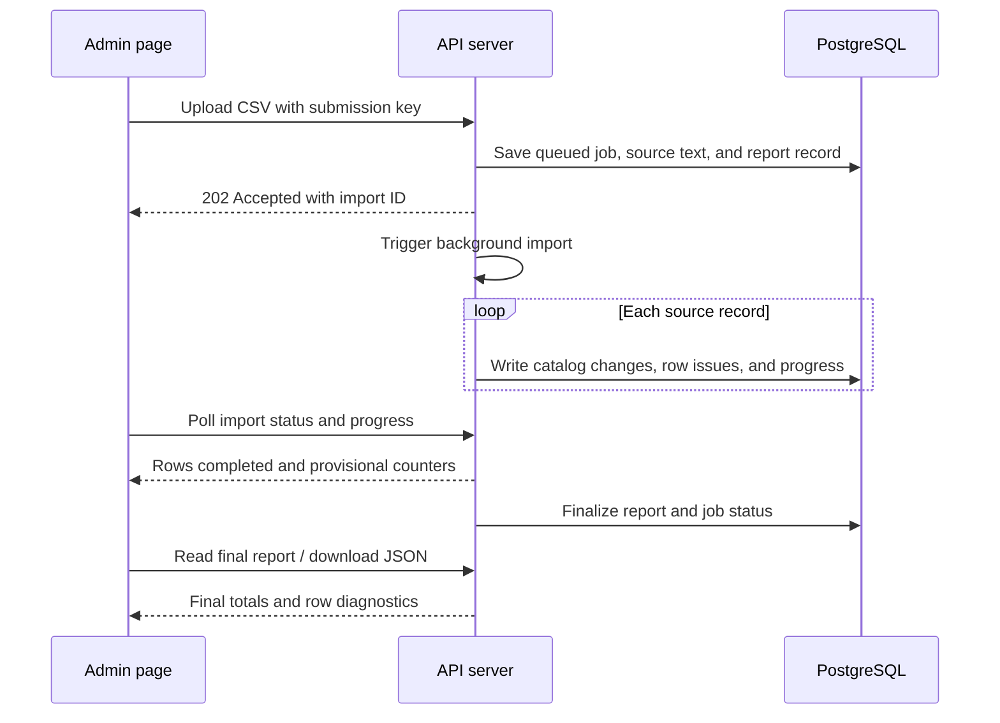

# Data import pipeline

ClearUp accepts CSV uploads through the admin imports page and processes them asynchronously inside the same API server. The upload request returns promptly; progress and reports are saved in PostgreSQL. No separate worker service or import CLI command is needed.

## From source data to catalog

A separate datascraper produces CSV files. Review those files before uploading them through `/admin/imports`. Merchants must already exist; `bun run seed:merchants` is a separate, occasional setup command, not part of processing an upload.

| Upload | Purpose | API endpoint |
| --- | --- | --- |
| Initialize Products | Create or update catalog fields and optionally the initial merchant offer | `POST /api/products/admin/import/csv` |
| Add Merchant Offers | Add reviewed, matched offers to existing products | `POST /api/products/admin/import/offers` |
| Refresh Prices | Update price and stock on existing offers, preserving their links | `POST /api/products/admin/import/prices` |

See [catalog import formats](features/product-catalog-and-merchants.md#admin-import) for columns, price rules, and matching behavior.

## Accept, process, report

1. The controller validates the request. Imports require an admin session, `x-clearup-client: 1`, and `x-import-submission-key`. Raw CSV requests have a 15 MB limit.
2. The API saves the decoded source text and report record in one transaction. The submission key prevents duplicate submissions from the same account; reusing it with different content or import type returns `409`.
3. The API returns `202` with an import ID. Initial zero counters are placeholders, not final totals. Closing the browser does not cancel an accepted import.
4. The background processor handles one import at a time. Additional accepted uploads wait for their turn. When the current import ends, processing continues with the next upload from this server session. There is no continuous queue polling loop.
5. The existing import services validate and write rows, persist issues, and checkpoint progress. Requests to the API can continue while asynchronous import work runs, though both share server CPU, memory, and database connections.
6. The admin page polls history/detail endpoints for progress. Once processing finishes, the report provides final totals and issues, including record numbers, source line ranges, processing stage, outcome, and reason. Fix the source CSV and upload again as needed.

## Status and reports

Jobs progress from `queued` to `processing`, then `completed`, `partial`, or `failed`. An interrupted or unsafe-to-continue job becomes `needs_review`.

Progress counters are provisional. Catalog writes, issue storage, and progress checkpoints commit separately, so an interruption can leave a successful write beyond the last saved checkpoint. A row can also have partial success if a later step fails. `reportComplete` indicates whether report totals are final.

History and report endpoints are admin-only. They expose summaries and diagnostics, not the retained CSV payload. The JSON download includes all recorded issues; pagination only limits what the page displays. Source payloads, jobs, and reports are retained; there is no automatic cleanup.

## Restarts and manual reimports

The API initializes import processing after database setup and migrations. On startup it marks previously unfinished jobs `needs_review`, preserving their reports and partial results. It does not resume or replay them. This design assumes one API instance; overlapping instances would require revisiting startup handling.

If saving an interrupted job's status and incomplete report fails, the API makes three total attempts, waiting two seconds between failures. It never retries CSV processing. If all attempts fail, it logs the import ID and continues with other accepted uploads; startup cleanup revisits any unfinished jobs on the next restart.

On a graceful shutdown, the server stops accepting new work and claiming queued uploads, waits for the active import to finish, then closes database connections. A forced shutdown or deployment timeout can interrupt it. Pending uploads that do not start before shutdown require manual resubmission after restart.

For a `needs_review` import:

1. Inspect its saved progress, row issues, and catalog state.
2. Correct the CSV if needed and check whether newer catalog edits should be preserved.
3. Upload it as a new submission. The original job and report remain in history.

Product imports use upserts, which makes many repeated uploads safe, but they replace catalog fields and can overwrite later edits. A repeated upload is not a rollback. Never assume an interrupted import made no changes.

## Running the application

Local development uses `cd backend` followed by `bun run dev`. Production uses `bun run build` and `bun run start`; the existing API deployment starts import processing too. Startup applies migrations before accepting imports. No additional service, scheduler, or Docker entry point is required.

The main implementation files are `productController.ts` (acceptance), `ImportJobService.ts` and `ImportJobRepository.ts` (saved jobs), `ImportProcessorService.ts` (background execution), `ProductImportService.ts` (row processing), and `ImportReportService.ts` (reports), under `backend/src/`.
